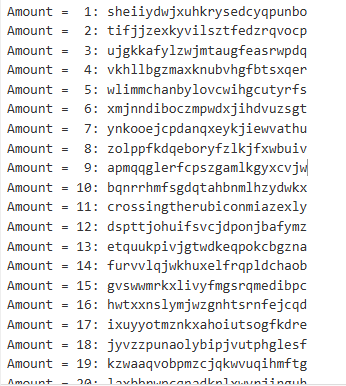

# caesar

DESKRIPSI 

Decrypt this message.

Message: [message](https://challenge-files.picoctf.net/c_fickle_tempest/6c40a1814a02fcc4bb567552d918c53b4b15a1b81518ec0ef7447fbfb73a3ce9/data.enc)

 
OVERVIEW

Caesar Cipher adalah salah satu metode mengenkripsi dengan melakukan penggeseran(shifting) kepada setiap huruf alfabet.

misalnya kita menggeser 2 kali, maka 'a' menjadi 'c', 'c' menjadi 'e', 'z' jadi 'b', dan seterusnya.

SOLUSI

hal pertama yang saya lakukan adalah mendownload file 'data.enc' yang diberikan

file tersebut bertipe 'ASCII text' dan berisi picoCTF{rgdhhxcviwtgjqxrdcbxpotman}

karena flagnya pasti bukan berisi string acak, maka saya harus mencari ide bagaimana cara mengubah string acak ini menjadi flag yang valid

mengingat stringnya berisi huruf semua dan judul dari tantangan ini juga caesar, maka saya tahu bahwa string acak ini adalah hasil enkripsi dari caesar cipher

saya menggunakan tool CyberChef untuk mendecode string acak ini

dikarenakan tantangan ini tidak memberitahukan berapa kali shift yang dilakukan, maka saya menggunakan Recipe 'ROT13 bruteforce' di CyberChef

setelah melihat hasil dari semua hasil bruteforce, ternyata hanya ada 1 hasil yang membuat kalimat masuk akal, yaitu kalimat dengan ROT11

FLAG 

picoCTF{crossingtherubiconmiazexly}

KESIMPULAN

Caesar Cipher encryption sangat tidak aman karena sangat gampang didecrypt meskipun tidak tahu berapa kali shift dilakukan
