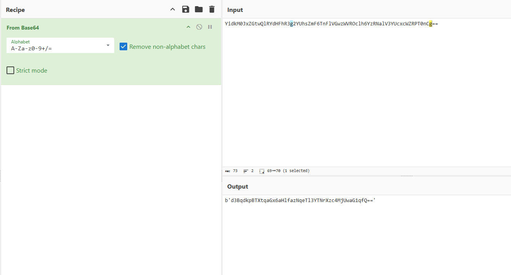
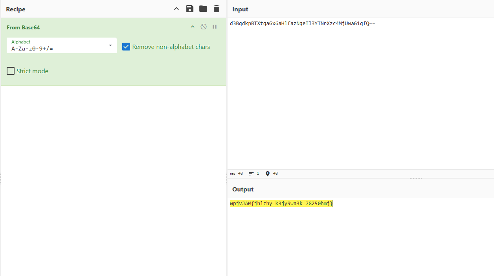
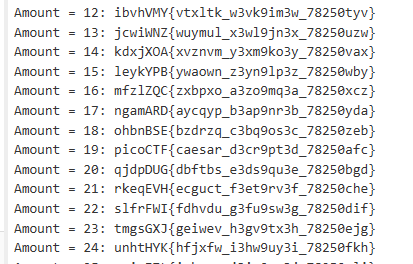

# interencdec

DESKRIPSI 

Can you get the real meaning from this file.

Download the file [here](https://artifacts.picoctf.net/c_titan/2/enc_flag)

 
OVERVIEW

- base64 adalah encoding yang mengambil 3 byte / 24 bit lalu memecahkannya menjadi 4 blok yang masing-masing berukuran 6 bit.
    tiap bloknya akan ditranslate dengan sebuah look-up tabel yang bersikan [a-zA-z0-9+=], cara kerjanya sama dengan ASCII tapi karakter yang dapat diartikan hanya 64

- Caesar Cipher adalah salah satu metode mengenkripsi dengan melakukan penggeseran(shifting) kepada setiap huruf alfabet.
    misalnya kita menggeser 2 kali, maka 'a' menjadi 'c', 'c' menjadi 'e', 'z' jadi 'b', dan seterusnya.

SOLUSI

hal pertama yang saya lakukan adalah mendownload file 'enc_flag' yang diberikan

file tersebut bertipe 'ASCII text' dan berisi YidkM0JxZGtwQlRYdHFhR3g2YUhsZmF6TnFlVGwzWVROclh6YzRNalV3YUcxcWZRPT0nCg==

karena flagnya pasti bukan berisi string acak, maka saya harus mencari ide bagaimana cara mengubah string acak ini menjadi flag yang valid

mengingat pola ini sudah sangat sering ditemukan, yaitu pola dengan string yang hanya mengandung [a-zA-z0-9+=], maka saya tahu bahwa 

string ini merupakan hasil encoding base64

saya menggunakan tool CyberChef untuk mendecode string acak ini

kita mendapatkan " b'd3BqdkpBTXtqaGx6aHlfazNqeTl3YTNrXzc4MjUwaG1qfQ==' " sebagai hasilnya, tetapi kita masih belum mendapatkan flag.

karena polanya masih pola base64, saya memutuskan untuk mengdecode stringnya lagi 

kita mendapatkan "wpjvJAM{jhlzhy_k3jy9wa3k_78250hmj}". Mengingat format flag pasti 'picoCTF' dan melihat pola string ini,

saya menyimpulkan bahwa string ini merupakan string yang sudah diencrypt dengan ROT. Gunakan recipe 'ROT Brute Force' di CyberChefnya

FLAG 

 picoCTF{caesar_d3cr9pt3d_78250afc}

KESIMPULAN

- Base 64 adalah algoritma encoding bukan encryption, jadi memang tidak bermaksud untuk menyembunyikan pesan.
- Caesar Cipher encryption sangat tidak aman karena sangat gampang didecrypt meskipun tidak tahu berapa kali shift dilakukan

