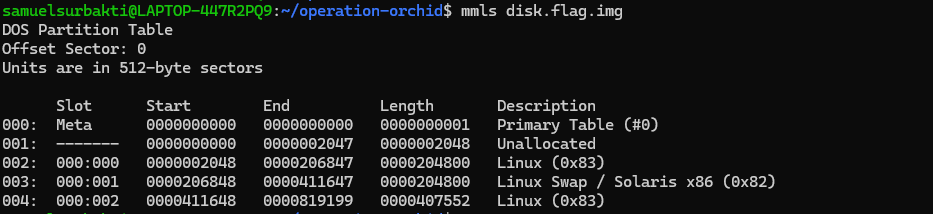
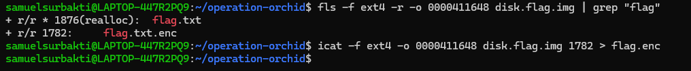
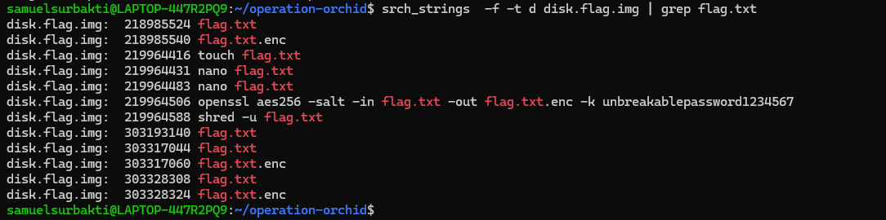
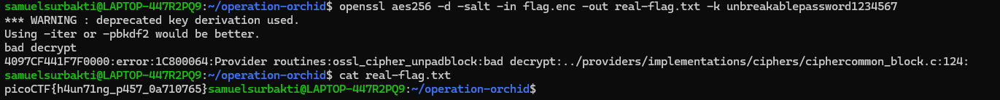

# operation orchid

DESKRIPSI 

Can you find the flag in this disk image? Wrap what you find in the picoCTF flag format.

Note: if you are using the webshell, download and extract the disk image into /tmp not your home directory.

[Download the disk image here](https://artifacts.picoctf.net/c/212/disk.flag.img.gz)

OVERVIEW
- OpenSSL adalah tool kriptografi yang berguna untuk banyak hal, salah satunya untuk mengenkripsikan data dengan banyak algoritma 
    pengenkripsian yang bisa dipilih

- Salah satu algoritma enkripsi yang bisa figunakan untuk AES-256 yang merupakan jenis enkripsi simetris. key yang digunakan 
    harus tepat 256 bit (32 byte), tapi dengan fitur 'salt', plain password kita akan diproses sehingga memenuhi standar password AES-256

- bash adalah salah satu jenis CLI Linux yang berguna untuk meng-translate plain teks menjadi sebuah serangkaian program. di linux, terdapat
    file khusus berisi bash-history yang  menyimpan riwayat command line yang digunakan di bash

SOLUSI

hal yang pertama kita lihat adalah untuk melihat isi partisi disk.

lalu kita mengecek tiap isi dari partisi dengan command 'fls'. pada partisi linux pertama, tidak terdapat apa- apa

kita melanjutkan untuk mengecek partisi ke 3, lalu kita mendapatkan sebuah file 'flag.txt.enc' dan 'flag.txt'. Di sini kita fokus untuk 'flag.txt.enc' 
dikarenakan file satunya lagi sudah terhapus permanen.

lalu kita melihat 'flag.txt.enc' dengan command 'icat' lalu membuatnya menjadi sebuah file baru. 

dari namanya kita tahu bahwa file ini tidak akan berisi flag langung karena tertulis .enc

oleh karena itu, kita perlu mengecek jenis file dari 'flag.txt.enc'. 

flag.enc: openssl enc'd data with salted password

ternyata file ini berisikan sebuah file yang sudah dienkripsikan dengan openssl dengan tambahan fitur salted password.

saya juga baru tahu bahwa ternyata linux merecord semua history command yang digunakan di bash di file bash-history.

dengan pengetahuan ini, kita bisa melihat apakah sebelumnya file ini pernah dimanipulasi. Untuk mempermudahnya kita tangkap 'flag.txt'

dari sini, kita tahu bahwa file ini terenkripsi dengan openssl dengan algortima aes-256 dengan fitur salt dan password 'unbreakablepassword1234567'

kita bisa langsung mengdekripsikannya dengan pengetahuan yang ada.

FLAG

picoCTF{h4un71ng_p457_0a710765}
