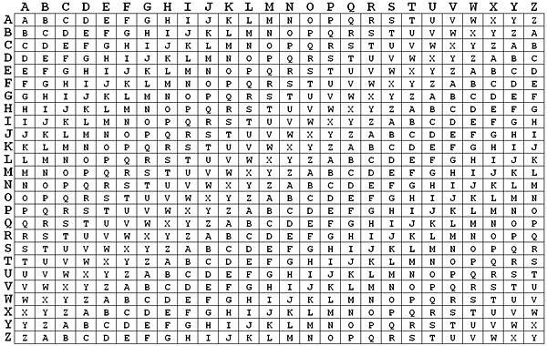
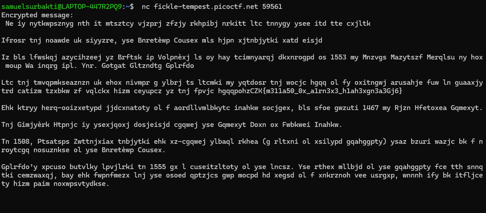

# la cifre de 

DESKRIPSI 
I found this cipher in an old book.
diberikan sebuah ascii text dari server menggunakan command nc 

OVERVIEW
- Vigenere adalah metode encrypt menggunakan key, keynya akan diiterasikan sehingga tiap karakter pada message
  mempunyai pasangan karakter dari key. hasil encryptnya hanyalah penjumlahan antara Alphabet[ ( message[i] +  key yang sudah dimap dengan message[i] ) % 26] 

tapi jika ingin cara encrypt manual dengan tabel ini, maka pasangkan message[i] sebagai kolom/baris lalu mapped-key sebagai kolom/baris lainnya.

Dengan ini kita akan mendapatkan cipher textnya

SOLUSI

setelah mendapatkan seukumpulan teks dengan nc, kita akan mendapatkan encrypted message.

dari teks ini, kita dapat melihat sebuah string yang mempunyai format flag, yaitu hgqqpohzCZK{m311a50_0x_a1rn3x3_h1ah3xgn3a3Gj6}

satu-satunya metode encypt yang mungkin saat saya pertama kali melihat ini adlah ROT-13

tapi setelah mencobanya, string tadi tidak akan pernah membuat prefix "picoCTF"

Setelah melihat petunjuk di internet, saya tahu bahwa pesan ini diencypt menggunakan vigenere encypt.

Sayapun membuat logaritmanya di dalam python, tetapi ada satu masalah, yaitu kita tidak diberitahukan key-nya

tapi dengan informasi hgqqpohzCZK{m311a50_0x_a1rn3x3_h1ah3xgn3a3Gj6}, kita tau bahwa "pohzCZK" == "picoCTF"

dengan informasi ini, kita dapat mengeekstrak key yang digunakan, yaitu "agflagf, maka saya asumsikan kunci yang digunakan

adalah "agfl" mengingat pola "af" mungkin saja perulangan dari "agfl"

dengan key ini, kita berhasil mendapatkan flag dengan kode python yang sudah dibuat sebelumnya
FLAG

picoCTF{b311a50_0r_v1gn3r3_c1ph3rbc3a3Ae6}
