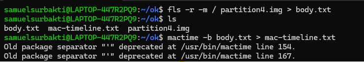
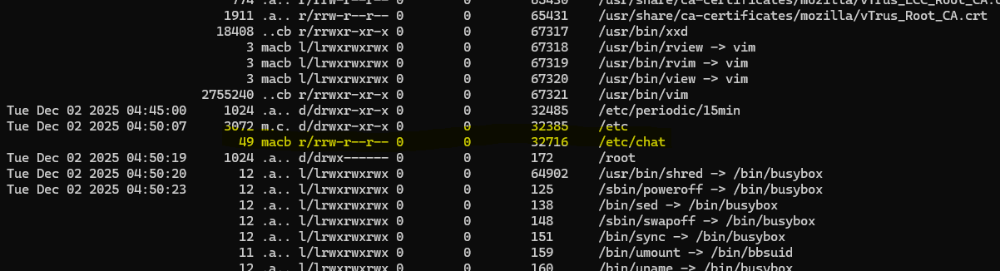
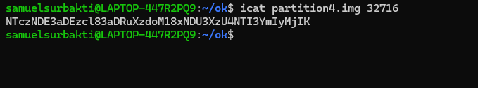

# timeline 1

DESKRIPSI 
Can you find the flag in this disk image? The right one is Linux! One wrong step and its all gone!

Download the disk image [here](https://challenge-files.picoctf.net/c_plain_mesa/fef9e3937fced503da228c6affaea69ed51d6234ed8fde14a52b573777b869e7/partition4.img.gz)

OVERVIEW
- MAC timeline adalah timestamp di disk tentang kapan file Modified/isi file diubah, Access/file diakses, Change/metadata diubah.

    untuk melihat MAC timeline di disk ini, kita menggunakan 'fls -r -m / [nama partisi]'. opsi m untuk membuat output fls menyertakan mac-nya. output dari command ini akan menghasilkan 'body file', isinya sudah lengkap, tapi susah untuk dibaca.

- mactime adalah command yang digunakan untuk membuat body file gampang dibaca. gunakan 'mactime -b [nama file]'

SOLUSI

hal yang pertama kita lihat adalah jenis file system dari partisinya, menggunakan command 'file'

sebelum tau apa itu MAC Timeline, saya mencari file flag di partisi menggunakan 'fls -f ext4 [nama partisi]', tapi tidak mendapatkan apapun

setelah melihat hint dan mencari tahu apa itu MAC timeline, saya langsung membuat file yang berisikan mac timeline

lalu membukanya dengan 'cat', setelah diselidi dan dengan bantuan hint, kita tahu bahwa kita ingin membuka recent file dan 

file dengan timestamp macb, setelah menganalisis mac timeline, kita tahu seseorang telah membuat file /etc/chat

setelah membukanya dengan 'icat' dengan offset yaang sudah diketahui sebelumnya kita mendapatkan sebuah string

dengan melihatnya sekilas, saya tahu bahwa string ini adalah string 64bit encoded

dan setelah didecode, ternyata benar bahwa ini adalah flag yang dicari

FLAG

picoCTF{573417h13r_7h4n_7h3_1457_58527bb222}
